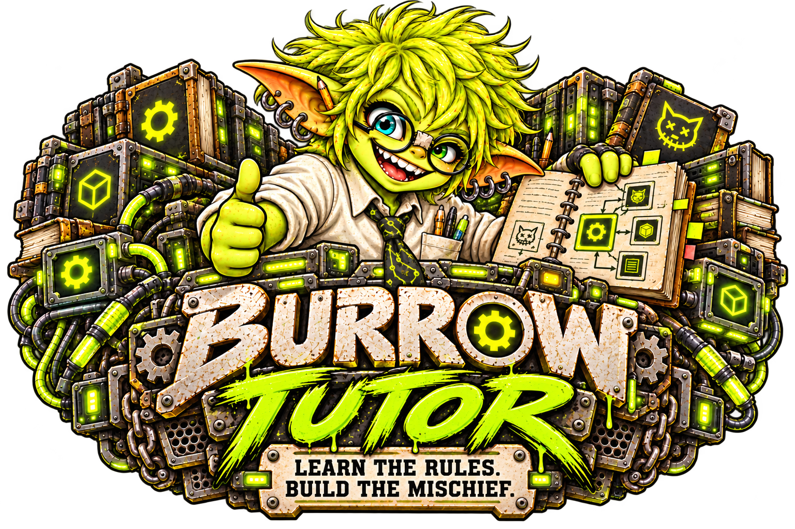

# Burrow Tutor: learn to build mods



**Learn the rules. Build the mischief.**

Fred is your tutor. His first lesson: cleanup hooks are a sign of character.

Burrow Tutor puts the public third-party mod contract beside a small reference mod you can read, test, and adapt. It uses plain JavaScript ESM, no framework, no third-party package dependencies, and no generated build source.

## Beginner lessons

1. [Run and test Tutor](testing.md).
2. [Install and try the reference mod](install.md).
3. [Understand how the example works](walkthrough.md).
4. [Read the mod author contract](contract.md).
5. [Add optional Forge images](forge-images.md).
6. [Adapt and release your own mod](release.md).

## Advanced lessons

Continue within Tutor with [Advanced lessons](../advanced/index.md): agents and operator metadata, complete conversation reads, isolated model generation, scheduler jobs, diagnostics, persistent data, protected results, UI contributions, and lifecycle/recovery. The [coverage matrix](../advanced/coverage.md) connects each capability to source, lessons, tests, and verification gaps.

Both sections belong to the same Tutor repository. The installed reference remains small; Advanced examples are supplied alongside it for deliberate use in your development copy.

## What you need

- Node.js 22.13 or newer.
- Git to clone the repository.
- A Core backend checkout for the full test suite and current-Core integration test (the `backend/` directory in the public Burrow repository works). You can run the isolated server/UI tests without it.
- A development Burrow installation to try the complete mod lifecycle.

```sh
git clone https://github.com/GoblinKing-Burrow/Burrow-Tutor.git
cd Burrow-Tutor
```

## Find your way around

- `burrow.mod.json`: identity, version, server/UI entry points, and Settings contribution.
- `server/index.mjs`: activation, routes, public settings, write-only secrets, one agent tool, and cleanup.
- `server/forge-images.mjs`: disabled-by-default image request scaffold with paid consent and durable retries.
- `docs/forge-images.md`: the Forge lesson; Tutor has no separate lesson engine or code generator.
- `ui/control.js`: status panel and refresh.
- `ui/settings.js`: configuration form and cleanup.
- `server/advanced/index.example.mjs`: optional Advanced capability-lab entrypoint.
- `docs/advanced/`: Advanced lessons and capability coverage matrix.
- `ui/archive.js`, `ui/declarative-settings.example.js`: optional UI examples.
- `test/`: Beginner, Advanced, lightweight UI, and current-Core integration tests.
- `docs/mod-contract.md`: the canonical public contract.

The repository name is Burrow-Tutor. The installed example’s manifest ID is `burrow-reference-mod`, and its installed, in-Burrow display name is **Tutor**.

## Before you install

Mods are trusted executable server/browser code. A forked host limits faults and exposed Core APIs; it is not an operating-system sandbox. Install only code you trust. Installation does not grant agent tools.

These guides include the current Beginner and Advanced examples. Public snapshots follow the daily sync, so a guide can lead an installed release by one day. Check [installation readiness](install.md#release-readiness) and test the Core version you use.

[Browse the source](https://github.com/GoblinKing-Burrow/Burrow-Tutor) · [Read the license](../../LICENSE)
